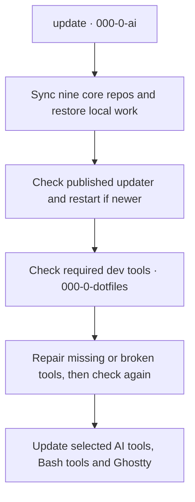

# 000-0-ghostty

<!-- key-information:start -->
## Key information

- **Description:** Runs the Ghostty terminal on RHEL 10 as a Flatpak built from the signed release, with bash integration and the current configuration.
- **Tier:** `0`. Core. Every project must follow its rules, with no exceptions.
- **Needs:** The `update` command from 000-0-ai, Flatpak, and the Nerd Fonts and bash setup from 000-0-dotfiles.
- **Gives:** The Ghostty terminal with current GTK and libadwaita, and its configuration.
- **On a new computer:** set it up step 7 of 7 in the core tier.

This folder is part of the `~/Apps` SOP (Standard Operating Procedure). The
number in the name of each folder is its tier. The SOP map is at
<https://claude.ai/artifact/W1ajTT5RGF5ZmKuJ4cRAwa>. It is a private claude.ai page. Log in to open it.

| Folder | Tier | Goal | GitHub |
|---|---|---|---|
| `000-0-dotfiles` | 0 | Every computer works the same way | [000-0-dotfiles](https://github.com/kairin/000-0-dotfiles) |
| `000-0-ASD-STE100` | 0 | Every document is clear to a reader who is not a developer | [000-0-ASD-STE100](https://github.com/kairin/000-0-ASD-STE100) |
| `000-0-password` | 0 | No key gets to a program that does not need it | [000-0-password](https://github.com/kairin/000-0-password) |
| `000-0-ai` | 0 | AI tools work the same way on every computer and follow the SOP | [000-0-ai](https://github.com/kairin/000-0-ai) |
| `000-0-workspace` | 0 | All repositories in `~/Apps` stay healthy and consistent | [000-0-workspace](https://github.com/kairin/000-0-workspace) |
| `000-0-tables` | 0 | You never research the same database question twice, and what you know links across repositories | [000-0-tables](https://github.com/kairin/000-0-tables) |
| **000-0-ghostty** | 0 | The terminal is current, verified and the same on every computer | [000-0-ghostty](https://github.com/kairin/000-0-ghostty) |
| `000-111-learn` | 111 | Write very small, fast programs that run close to the hardware | [000-111-learn](https://github.com/kairin/000-111-learn) |
<!-- key-information:end -->

This repository holds the Ghostty configuration and the facts about how
Ghostty is installed. It has no install script. The command that installs and
updates Ghostty is in 000-0-ai.

## Contents

| Path | What it is | Install location |
|---|---|---|
| `config.ghostty` | The Ghostty configuration: font, Catppuccin Mocha theme, window, clipboard and keybinds. | `~/.var/app/com.mitchellh.ghostty/config/ghostty/config.ghostty` |
| `bashrc.d/90-ghostty.sh` | Loads Ghostty's bash integration in the host shell. It loads after the other `~/.bashrc.d` tools and before ble.sh attaches (`99-blesh-attach.sh`). | `~/.bashrc.d/90-ghostty.sh` |

## Where each part lives

| Part | Repository | Path |
|---|---|---|
| Install and update command (`update`) | [000-0-ai](https://github.com/kairin/000-0-ai) | `local-bin/update`, installed by `local-bin/install-update.py`. Documentation: README section "Update command" and its "Ghostty" subsection. |
| Agent skill and Claude prompt hook for updates | [000-0-ai](https://github.com/kairin/000-0-ai) | `skills/update/SKILL.md`, `hooks/claude/update_reminder.py` |
| Nerd Fonts | [000-0-dotfiles](https://github.com/kairin/000-0-dotfiles) | `docs/nerd-fonts.md` |
| Bash setup and `~/.bashrc.d` (ble.sh, Starship, atuin, fzf, zoxide, direnv) | [000-0-dotfiles](https://github.com/kairin/000-0-dotfiles) | `docs/configuration-reference.md` (section bash), `docs/rhel-10-setup.md` |
| Routine maintenance (run `update`) | [000-0-workspace](https://github.com/kairin/000-0-workspace) | README section "AI, Bash tool and Ghostty maintenance" |
| Ghostty configuration | This repository | `config.ghostty`, `bashrc.d/90-ghostty.sh` |

## Why a Flatpak

Ghostty is not in the RHEL 10 or EPEL 10 repositories. A native build works,
but RHEL 10 has older GTK and libadwaita than Ghostty can use:

| Library | RHEL 10 | GNOME 49 Flatpak runtime | Newest Ghostty use |
|---|---|---|---|
| GTK | 4.16 | 4.20 | 4.20 |
| libadwaita | 1.6 | 1.8 | 1.8 |

GTK 4.20 needs glib 2.82 and pango 1.56. RHEL 10 has glib 2.80 and pango 1.54.
A native GTK 4.20 means you build glib, pango and GTK yourself. The Flatpak
gets them from the GNOME runtime instead. The build uses Ghostty's own
manifest, `flatpak/com.mitchellh.ghostty.yml`, from the release source.

A native build also needs Zig at the exact version that the Ghostty release
names (0.15.2 for 1.3.x). EPEL has a different version. The Flatpak manifest
downloads the correct Zig, so you do not install Zig.

## Install on a new computer

Do the steps for 000-0-dotfiles (Nerd Fonts, bash) and 000-0-ai (`update`)
first.

1. Install the build tools and add the Flathub remote:

   ```bash
   sudo dnf install flatpak-builder minisign
   flatpak remote-add --user --if-not-exists flathub https://dl.flathub.org/repo/flathub.flatpakrepo
   ```

   `flatpak` is in RHEL 10. `flatpak-builder` is in AppStream and `minisign`
   is in EPEL.

   Flathub is used only for the GNOME runtime and SDK of this build. This is
   the one exception to the "no Flathub" rule. Other applications stay RPM
   packages. See `docs/decisions.md` in 000-0-dotfiles, entry 2026-10-11.

2. Build and install Ghostty:

   ```bash
   update --only ghostty
   ```

   The command downloads the newest release, checks its minisign signature,
   builds it and installs it as the user Flatpak `com.mitchellh.ghostty`.
   The first build also installs the GNOME runtime and SDK (about 2 GB) and
   takes several minutes. Expect: `ghostty: okay (updated none -> X.Y.Z; ...)`.

3. Install the configuration from this repository:

   ```bash
   mkdir -p ~/.var/app/com.mitchellh.ghostty/config/ghostty ~/.bashrc.d
   cp config.ghostty ~/.var/app/com.mitchellh.ghostty/config/ghostty/config.ghostty
   cp bashrc.d/90-ghostty.sh ~/.bashrc.d/90-ghostty.sh
   ```

4. Check the configuration:

   ```bash
   flatpak run com.mitchellh.ghostty +validate-config
   ```

   Expect: no output and exit code 0.

5. Start Ghostty from the application menu, or run
   `flatpak run com.mitchellh.ghostty`.

## Update

The updater release is **1.0.002** (**2026-10-15**), owned and published by
`000-0-ai` as
[`update-v1.0.002`](https://github.com/kairin/000-0-ai/releases/tag/update-v1.0.002).
See its [installed-file inventory](../000-0-ai/README.md#installed-files) for
all destinations. Both installation modes copy the command and fingerprint
metadata; full installation also refreshes shared instructions, the update
skills and the Claude reminder hook. `--command-only` leaves agent integration
untouched. Neither installer mode installs or updates applications.

The command starts with its own version and code release date.
`update --version` displays just this identity without updating applications
or contacting the network; it does not report application versions.

Run `update` (all tools) or `update --only ghostty`. The command compares the
installed Flatpak with the highest numeric `X.Y.Z` or `vX.Y.Z` tag among
the first 100 tags returned by `ghostty-org/ghostty`. This target is discovered
at run time; the updater does not pin a Ghostty release number. If
Ghostty is missing or older, it builds and installs the new release in place,
checks that it starts, and removes the build files and unused Flatpak
runtimes. Restart Ghostty to use the new version. `flatpak update` does not
update Ghostty, because it is a local build.

The result reports version evidence and identifies numeric tags as the target
source. Expected per-tool failures are reported without preventing other
selected tools from updating. The updater itself is a tested copy from
`000-0-ai`: `update --check-self` compares local source and installation
fingerprints without updating applications. After reviewed updater changes,
refresh the command with
`python3 ~/Apps/000-0-ai/local-bin/install-update.py --command-only`.
The full installer also refreshes AI context,
skills and the reminder hook. See the shared
[update procedure](../000-0-ai/README.md#update-command).

## Facts about the Flatpak

- **Configuration folder.** Inside the Flatpak, `XDG_CONFIG_HOME` is
  `~/.var/app/com.mitchellh.ghostty/config`. Ghostty does not read
  `~/.config/ghostty`. Ghostty 1.3 uses the file name `config.ghostty`.
- **Shell.** Ghostty starts your login shell on the host, not in the sandbox.
- **Bash integration.** Ghostty cannot inject its bash integration from the
  Flatpak, because the sandbox cannot open the Flatpak install folder. It
  logs `shell could not be detected`. `bashrc.d/90-ghostty.sh` sources the
  same file from the host. This turns on the `sudo`, `ssh-env` and `title`
  features in `config.ghostty`. The file name starts with `90-` so that it
  loads before ble.sh attaches. Tested on 2026-10-11 with ble.sh, Starship
  and atuin: all Ghostty hooks are active.
- **TERM.** Ghostty sets `TERM=xterm-ghostty` and points `TERMINFO` to a host
  path in the Flatpak install. Programs on the host find it, so no `terminfo`
  install is needed.
- **Home folder.** The Flatpak can read your home folder but cannot write to
  it. Programs that you run in the terminal run on the host and are not
  limited.

## Change the configuration

1. Edit `config.ghostty` in this repository.
2. Copy it to the install location (step 3 above).
3. Run `flatpak run com.mitchellh.ghostty +validate-config`.
4. Press `Ctrl+Shift+,` in Ghostty to reload the file.

Rules for the file:

- Do not add `background-blur`. It causes crashes on Linux.
- Keep `scrollback-limit` at 50000 or lower.
- Use a font that `fc-list : family | grep 'Nerd Font Mono'` shows.

## Core repository sync in `update`

Updater **1.0.002** starts each normal run with the nine core repositories.
It fetches remote `main` and advances local `main` only when a fast-forward
is possible. It temporarily saves staged, unstaged and untracked changes in
a local Git recovery snapshot. It restores the original working branch and
local changes before it starts the next repository. Ignored files stay in
place. It keeps the recovery snapshot and records incomplete restoration.

This routine sync does not commit or push unfinished work. If a repository
cannot sync or restore its local work, the command reports an incomplete
result and stops before updater replacement or application updates. Existing
merge operations, diverged history and unresolved recovery records need
attention. The command does not discard local commits or force a reset.

After all nine repositories sync and restore, the command checks published
`update-v*` releases in `000-0-ai`. It installs newer updater code from the
exact published tag, then restarts once with the original arguments. It does
not install unreleased working tree code. Application updates run last.
`--only` limits application updates, not the nine-repository sync.
`--version` and `--check-self` remain local checks. `--dry-run` makes no changes.

The owner release sequence is `1.0.001` through `1.0.999`, then `1.1.0`.
This is the updater version scheme, not application version pinning.
See the [shared update procedure](../000-0-ai/README.md#update-command) and
[repository sync requirements](../000-0-workspace/docs/repository-protection.md#routine-core-sync-in-update).

## Update startup and automatic calls

Run `update` as your normal user for routine maintenance. It calls the doctor
and installer automatically when needed.



This diagram shows the successful path. A failed sync, release check or tool
repair stops the process before app updates. Healthy tools need no repair.

| Need | Command |
|---|---|
| Routine maintenance | `update` |
| Read-only tool check | `dev-doctor` |
| Show a repair plan | `dev-install` |
| Apply repairs | `dev-install --apply` |

Only system-package repairs through DNF need sudo. If needed, run `sudo -v`
first. Repairs use `sudo -n` and fail if authorization expires.
Never run `sudo update`. User-owned binary and Ruff repairs need no sudo.

`000-0-ai` owns the updater. `000-0-dotfiles` owns the doctor, installer and
catalog. `000-0-workspace` owns the
[full procedure](../000-0-workspace/docs/update-and-development-tools.md),
including first setup, failure paths, preview limits and the ownership table.
See [dotfiles](../000-0-dotfiles/README.md#development-tools) for tool details.

## Workflow review — 2026-10-15

The live run found numeric Ghostty version `1.3.1`, equal to its numeric tag
target. The binary's `1.3.1-dev+0000000` and `tip` labels are expected for an
official release source-tarball build unless its version string is overridden;
they do not by themselves identify a nightly build.

The next assurance improvement is a durable build receipt with the source tag,
archive digest, signature result, build flags and installed Flatpak commit.
That receipt would support later source-provenance checks in addition to
numeric freshness. See
the owner's [adversarial workflow review](../000-0-workspace/docs/update-workflow-review-2026-10-15.md)
and its upstream Ghostty references.
